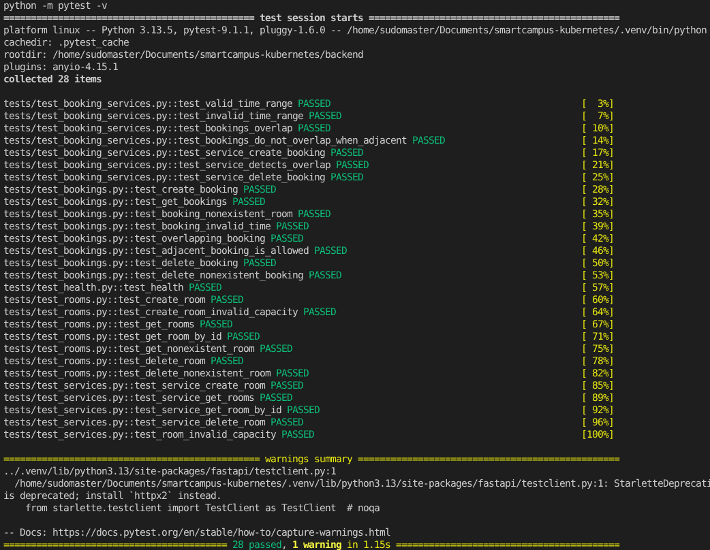
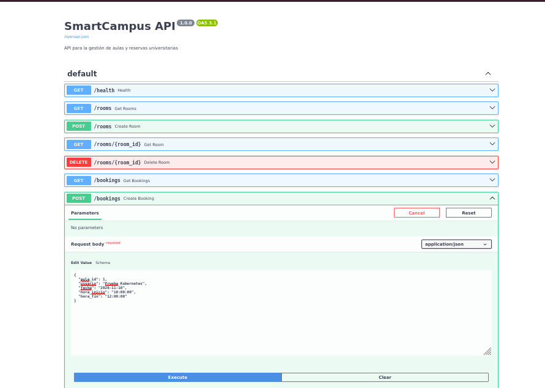
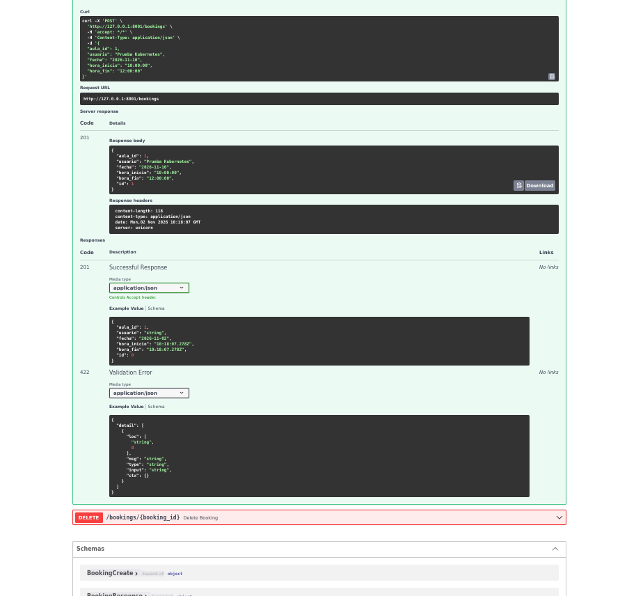
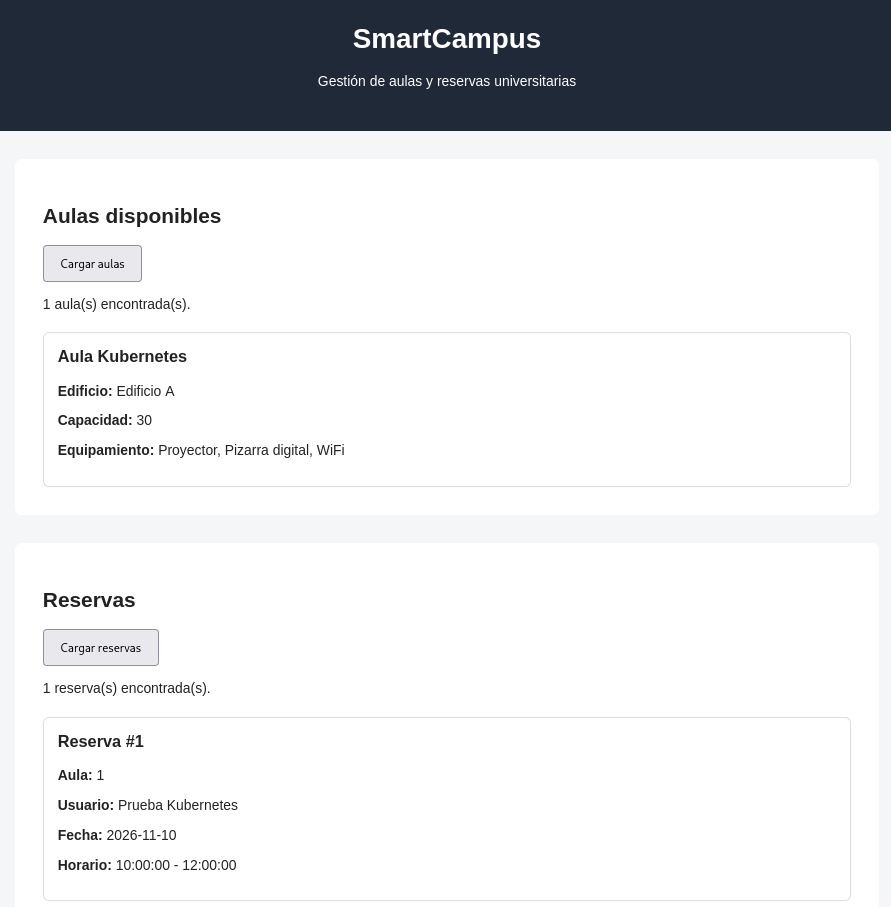
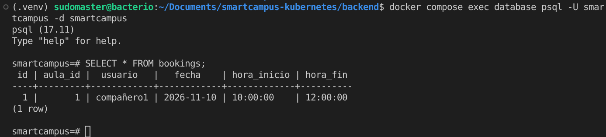
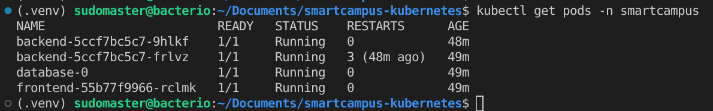
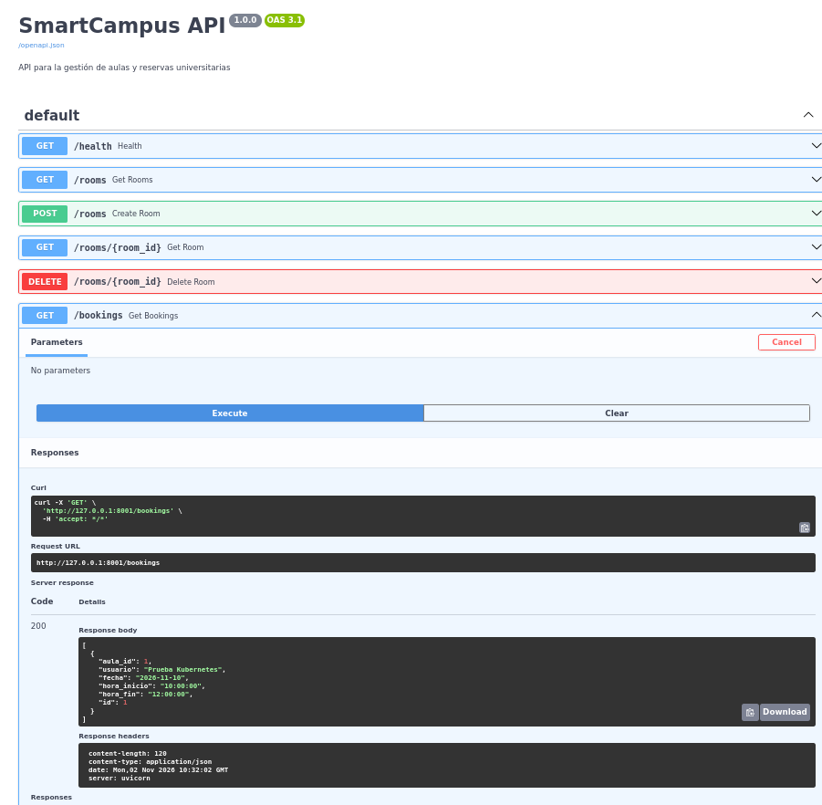
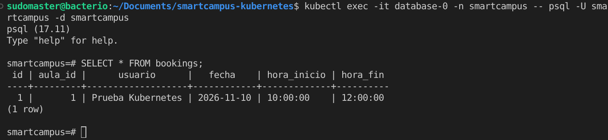

## Tests

El proyecto utiliza Pytest para ejecutar pruebas automáticas.

Se han implementado tests unitarios y tests de integración.

### Tests de integración

Los tests de integración comprueban los endpoints HTTP de la aplicación:

- `GET /health`
- `POST /rooms`
- `GET /rooms`
- `GET /rooms/{id}`
- `DELETE /rooms/{id}`

También se comprueban casos de error como:

- Capacidad igual o menor que 0.
- Consulta de un aula inexistente.
- Eliminación de un aula inexistente.

### Tests unitarios

Los tests unitarios comprueban directamente las funciones de `services.py`, incluyendo:

- Creación de aulas.
- Consulta de aulas.
- Consulta por ID.
- Eliminación de aulas.
- Validación de capacidad.

Para ejecutar todos los tests, dentro del proyecyo, en la terminal ejecutamos:

python -m pytest -v

Los 13 test comprobamos se ejecutan de manera correcta.


## Git Hooks

El proyecto utiliza Git Hooks para automatizar comprobaciones durante el desarrollo.

Los hooks se encuentran en:

```text
.githooks/
```

Para indicar a Git que utilice esta carpeta se debe ejecutar:

```bash
git config core.hooksPath .githooks
```

### Pre-commit

Se ejecuta automáticamente antes de realizar un commit.

Realiza las siguientes comprobaciones:

- Ejecuta Ruff para comprobar la calidad del código.
- Ejecuta los tests unitarios.
- Si alguna comprobación falla, el commit es rechazado.

### Post-commit

Se ejecuta después de realizar correctamente un commit.

Genera localmente el archivo:

```text
commit-log.txt
```

El registro contiene:

- Autor.
- Fecha.
- Hash del commit.
- Mensaje del commit.

El archivo `commit-log.txt` está incluido en `.gitignore` y no se almacena en el repositorio.

### Pre-push

Se ejecuta automáticamente antes de realizar un push.

Ejecuta todos los tests del proyecto mediante:

```bash
python -m pytest -v
```

Esto incluye los tests unitarios y los tests de integración.

Si algún test falla, el push es rechazado.

### Post-push

Git no dispone de un hook estándar nativo llamado `post-push`.

Para implementar este comportamiento se utiliza:

```text
.githooks/post-push
```

junto con el script:

```text
scripts/push.sh
```

El script realiza el `git push` normalmente y, si finaliza correctamente, ejecuta el script `post-push`.

Para utilizar el flujo completo en Windows:

```powershell
& "C:\Program Files\Git\bin\sh.exe" scripts/push.sh
```

Después de un push correcto se muestra:

```text
Cambios enviados correctamente al repositorio remoto.
```

## Docker

La aplicación puede ejecutarse dentro de un contenedor Docker.

El proyecto utiliza una imagen basada en Python y ejecuta la aplicación FastAPI mediante Uvicorn.

### Construir la imagen

```bash
docker build -t smartcampus .
```

### Docker Compose

El proyecto incluye un archivo `docker-compose.yml` que permite iniciar la aplicación de forma automatizada.

Para construir e iniciar el servicio:

```bash
docker compose up --build
```

Para ejecutarlo en segundo plano:

```bash
docker compose up -d
```

Para detener los contenedores:

```bash
docker compose down
```

### Servicio backend

Docker Compose define el servicio `backend`, encargado de ejecutar la API SmartCampus.

La aplicación queda disponible en:

```text
http://127.0.0.1:8000
```

La documentación Swagger está disponible en:

```text
http://127.0.0.1:8000/docs
```

El endpoint de comprobación de estado es:

```text
GET /health
```

### Healthcheck

Docker Compose incluye un `healthcheck` que consulta periódicamente el endpoint `/health`.

El estado del contenedor puede comprobarse mediante:

```bash
docker compose ps
```

Cuando la aplicación funciona correctamente, el contenedor aparece con estado:

```text
healthy
```

### Persistencia

La aplicación utiliza SQLite y un volumen Docker denominado `smartcampus-data`.

Este volumen permite conservar la base de datos aunque el contenedor sea eliminado y creado de nuevo.

### Variables de entorno

El archivo `.env.example` contiene las variables de configuración necesarias:

```env
APP_ENV=development
DATABASE_URL=sqlite:////data/smartcampus.db
HOST=0.0.0.0
PORT=8000
```

El archivo `.env` real no se almacena en Git.


## Gestión de reservas

SmartCampus permite consultar, crear y eliminar reservas de aulas.

### Endpoints

| Método | Endpoint | Descripción |
|---|---|---|
| GET | `/bookings` | Consultar todas las reservas |
| POST | `/bookings` | Crear una reserva |
| DELETE | `/bookings/{booking_id}` | Eliminar una reserva |

### Reglas de negocio

- El aula indicada debe existir.
- La hora de inicio debe ser anterior a la hora de fin.
- No se permiten reservas solapadas para la misma aula y fecha.
- No se puede eliminar una reserva inexistente.
- Se permiten reservas consecutivas sin solapamiento.

### Frontend

La interfaz web incluye una sección para consultar las reservas.

El frontend realiza la petición a `/api/bookings` y Nginx la reenvía al backend correspondiente.

### Validación

La funcionalidad de reservas se ha comprobado en:

- Ejecución local mediante pytest.
- Docker Compose.
- PostgreSQL en Docker.
- Kubernetes mediante `backend-service` y `database-service`.
- Frontend expuesto mediante `frontend-service`.

### Evidencias

Las siguientes capturas documentan las pruebas realizadas en ambos entornos.

#### 1. Tests automatizados (Pytest)

Se ejecutan los tests de integración y unitarios de la funcionalidad de reservas.



#### 2. Docker Compose

**Swagger: endpoints y creación de reservas**




**Frontend: aulas y reservas cargadas**



**PostgreSQL: reservas almacenadas**



#### 3. Kubernetes

**Pods: backend, frontend y PostgreSQL en ejecución**



**Swagger: API de reservas en Kubernetes**




**PostgreSQL: reservas almacenadas en Kubernetes**

